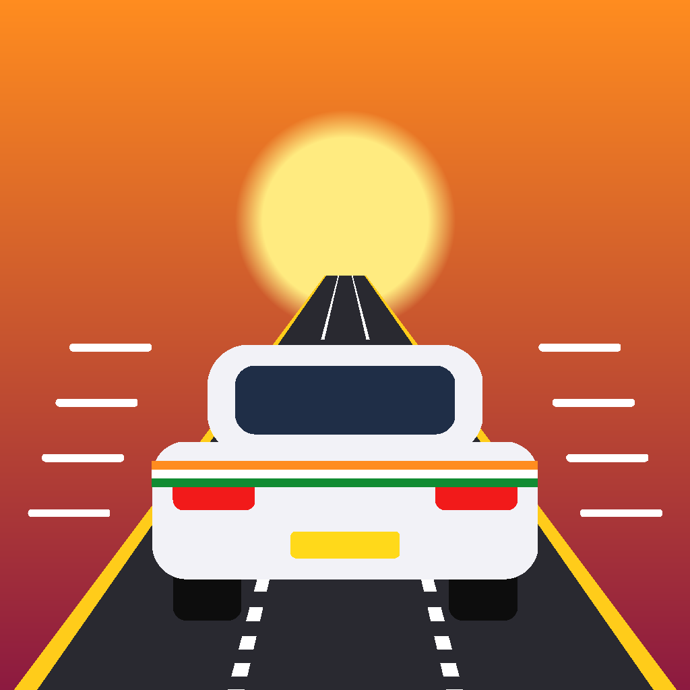

# Indian Traffic Rush

An endless 3D traffic-racing game set on Indian highways, built in **Unity 6** for **Android** (portrait). Weave past autos, trucks and buses, overtake, grab coins and hit nitro.

## Features
- Lane-based driving with gas, brake, nitro and horn; swipe or button controls
- Smart traffic: weighted spawning, overtakes, near misses, no impossible "walls"
- Garage: buy, paint and upgrade cars
- Daily missions, 15 achievements and a 7-day reward streak
- Day and sunset highways with procedurally built city scenery
- Every 3D model, sound effect and music loop is generated in code
- 28 automated tests (15 EditMode + 13 PlayMode)

## Tech
Unity 6000.3.8f1 · C# · Universal Render Pipeline · Input System · uGUI · Unity Test Framework

## Run it
1. Open this folder in Unity Hub with **6000.3.8f1**.
2. Run **ITR ▸ Setup Project** once.
3. Open `Assets/Scenes/MainMenu.unity` and press **Play** (Game view: portrait, e.g. 1080×1920).

More detail: [DEVELOPMENT_STATUS.md](DEVELOPMENT_STATUS.md) · Release steps: [RELEASE_GUIDE.md](RELEASE_GUIDE.md)

---
Made by [Niraj Kushwaha](https://github.com/nirajkushwaha98)
